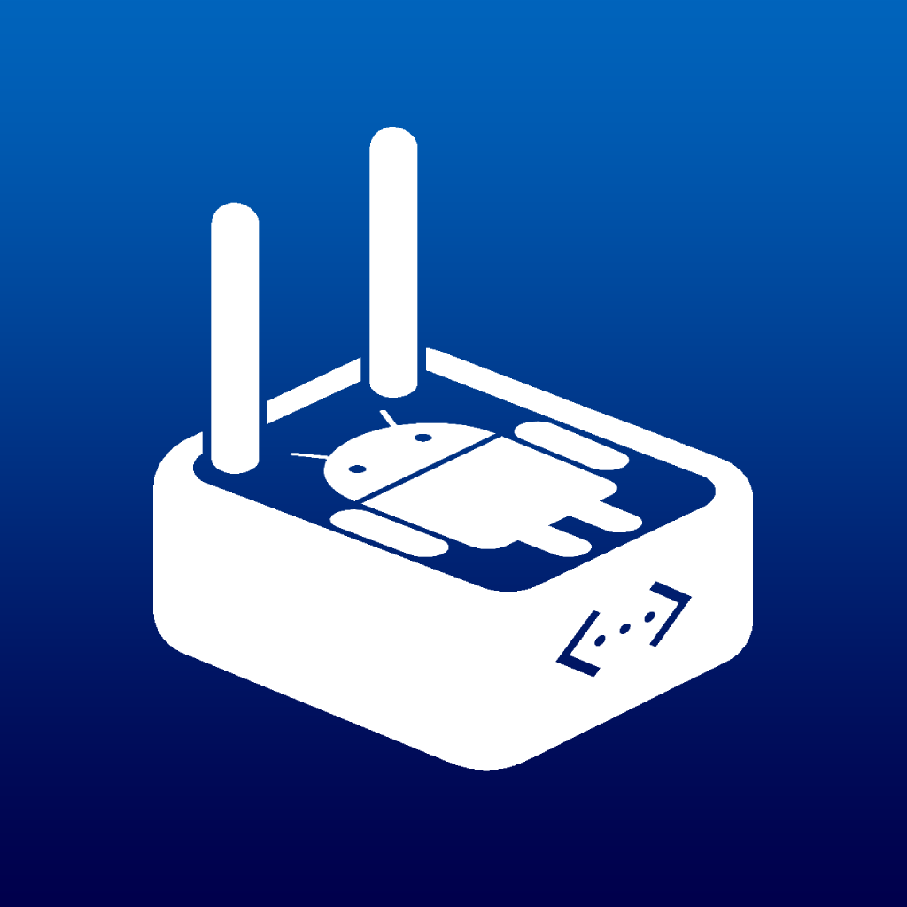

  

<h1 align="center">BridgeDroid</h1>

Screw it, connect a PS2 to your phone. Why not?

 

**Turn your rooted Android device into a proper WiFi-to-Ethernet bridge!**

### But why? Isn't there already an Ethernet tethering option in modern Android? 

Yeah, but it doesn't allow you to access LAN. Also, this works all the way back to Android 7.

## Usage 

Be sure to give the app root permissions. In most use cases. it's as simple as plugging in the device to your phone over a USB Ethernet dongle, connecting to a WiFi network, then turning it on. 

## Troubleshooting 

### Error: Interface 'x' not found! 

Press the "Interfaces" button and look for your dongle, most likely starting with eth or usb, and put it in "Eth Iface" 

### My interface does not appear! 

Make sure your device is properly connected. Also, ensure Ethernet is enabled. (Might be in Connections -> More connection settings -> Ethernet or similar.)

### [Guard] is blocking an IP in logs. 

You probably set the IP for the Ethernet device in settings, or the IP is already taken. Manually set a different IP, or go to your Ethernet settings, clear the IP and switch to DHCP.

